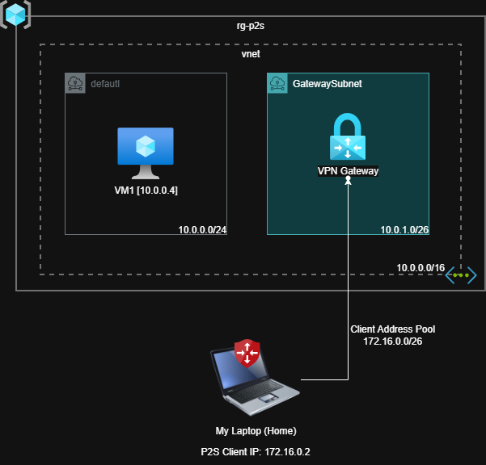

# Azure Point-to-Site VPN Lab

## Overview

This project demonstrates the implementation of an Azure Point-to-Site (P2S) VPN to provide secure remote connectivity from a client computer to resources hosted inside an Azure Virtual Network.

The lab was designed as a hands-on Azure networking exercise to explore VPN Gateway, GatewaySubnet, private IP addressing, remote connectivity, and Azure network architecture.

## Architecture

### Network Design

- Azure Virtual Network: `10.0.0.0/16`
- VM Subnet: `10.0.0.0/24`
- GatewaySubnet: `10.0.1.0/26`
- Virtual Machine: `10.0.0.4`
- P2S Client Address Pool: `172.16.0.0/26`
- Example VPN Client IP: `172.16.0.2`

## Architecture Flow

The connectivity flow implemented in this lab is:

Client Laptop
→ Point-to-Site VPN
→ Azure VPN Gateway
→ Azure Virtual Network
→ Azure Virtual Machine

Once connected to the VPN, the client receives an address from the configured P2S client address pool and can access resources inside the Azure Virtual Network through private connectivity.

## Point-to-Site Configuration

The Point-to-Site VPN uses the following client address pool:

`172.16.0.0/26`

After establishing the VPN connection, the test client received:

`172.16.0.2`

The Azure VM used to validate private connectivity has the following private IP:

`10.0.0.4`

## Validation

The VPN connection was validated from a client computer outside the Azure Virtual Network.

After establishing the VPN connection, the client received an IP address from the configured P2S address pool.

Example:

`172.16.0.2`

Connectivity to Azure resources was then tested through their private IP addresses.

## Key Concepts Practiced

This lab provided hands-on experience with:

- Azure Virtual Networks
- Azure Subnets
- Azure VPN Gateway
- GatewaySubnet
- Point-to-Site VPN
- Private IP addressing
- VPN client address pools
- Remote access to Azure resources
- Azure network troubleshooting

## Security Considerations

This environment was created for learning and demonstration purposes.

Authentication and access controls should be designed according to organizational security requirements before implementing a similar architecture in a production environment.

Sensitive information such as certificates, private keys, credentials, subscription IDs, and VPN client secrets should never be stored in a public GitHub repository.
